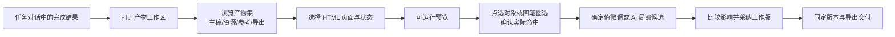
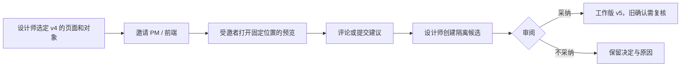

# AutoClaw Design Agent｜双任务信息架构 V13

> 2026-10-12 · 讨论稿。题目依据为用户提供的测试题截图；现有 AutoClaw 壳层依据用户截图和本地统一规范稿。以下是方案设计，不代表产品当前已经具备这些能力。

## 0. 先把两题分开

| | Task 1：Design 工作区 | Task 2：开放 Feature |
|---|---|---|
| 题目要点 | Design 任务结束后，查看、预览、编辑、管理多个 HTML 及相关产物 | 不受当前 Agent 能力限制，选择一个最值得增加的设计能力深入 |
| 本轮解法 | **产物工作区**：让设计任务从对话结果自然落到可查看、可修订、可交付的工作面 | **版本锚定的协作建议**：邀请 PM、设计师、前端在同一版本的具体位置提出建议，设计师以独立候选吸收 |
| 首要对象 | 一次 Design 任务产生的产物集，主产物是可运行 HTML 项目 | 已存在的一个产物版本、一个具体对象及其协作讨论 |
| 成功信号 | 不翻聊天记录也能找到主稿、打开正确状态、完成一次局部修改并导出同版本交付物 | 受邀者打开的就是指定版本与位置；建议不直接覆盖主稿；设计师能决定采纳 |
| 范围边界 | 单人使用也成立；无需实时多人在线 | 不作为 Task 1 的前置条件；本轮不做多人同步编辑或复杂权限系统 |

“邀请成员流程”原本只是原型里的示例页面，不是测试题的主任务。新版示例改为**AI 产品官网设计**，强调同一 Design 任务可产生多个页面、资源和导出件。Task 2 的“邀请成员”指邀请人参与设计评审，不再与示例页面名称混用。

## 1. Task 1 的核心场景与主链路

**起点**：设计师通过自然语言、PRD、截图等发起 Design 任务。Agent 产出首页 HTML、页面预览图及说明；更复杂的任务也可能包含多个 HTML 页面与运行资源。设计师需要确认哪个文件是主稿、哪些只是参考或派生图片，并把初版改到可交付。

**主链路**：



用户最常见的起手动作是“打开刚生成的结果”，因此入口应在 **Agent 完成消息的产物卡** 上，而不是要求先新建一个独立的设计项目。左侧仍是 AutoClaw 的项目与任务；中间保持任务对话；右侧出现与当前任务绑定的产物工作区。

### 1.1 右侧工作区的信息结构

```text
AutoClaw 原有壳层
├─ 左侧：项目 / 任务列表（沿用现有）
├─ 中间：当前 Design 任务对话
│  ├─ 输入材料与 Agent 执行记录
│  └─ 完成结果卡：打开工作区 / 继续提问
└─ 右侧：当前任务的产物工作区
   ├─ 顶部定位：任务名 / 工作版号 / 产物数量 / 当前状态
   ├─ 成果（默认）
   │  ├─ 产物集：主稿 HTML、运行资源、参考、派生输出
   │  ├─ 手动画板：拖放参考、截图、页面缩略卡并排序比较
   │  └─ 待处理提示：缺失资源、未预览状态、待审候选
   ├─ 预览与编辑
   │  ├─ 视图定位：方向 / 页面 / 状态 / 设备 / 版本
   │  ├─ 可运行 HTML 预览（与主稿同源）
   │  ├─ 定域入口：文字选中、DOM 点选、画笔圈选
   │  └─ 右侧上下文：对象属性 / AI 修改意图 / 范围与保留项
   └─ 版本与交付
      ├─ 工作版与隔离候选、差异及采纳记录
      ├─ 固定交付版本与运行入口
      └─ HTML 源码/资源、预览图、说明及已知问题
```

**文件不成为一级导航**：文件是产物集中的对象；选中后显示它的角色和可执行操作。HTML 主稿可运行、可编辑；图片可查看、标注、替换或加入画板；PRD/Figma 是引用输入。画板的价值是看全、排列与比较方向，不能把静态卡片误认为真正的 HTML 编辑器。打开某张 HTML 卡后进入聚焦预览；从预览可返回其在画板中的位置。

### 1.2 内容对象及关系

| 对象 | 必备信息 | 能做什么 |
|---|---|---|
| `DesignTask` | 任务 ID、输入、执行状态、当前工作版 | 关联对话与全部产物 |
| `ArtifactSet` | 一次生成批次、产物清单、主稿标识 | 在成果页看全，不依赖聊天翻找 |
| `SourceBundle` | HTML 入口、CSS/JS、被引用资源、运行方式 | 预览、编辑、导出，是可运行结果的权威源 |
| `Reference` | PRD、截图、Figma 链接、来源 | 查看、引用、放到画板；原文件不被悄悄改写 |
| `DerivedAsset` | 缩略图、截图、PDF 等、`derived_from_version` | 快速比对与分享；点开可回到来源视图 |
| `View` | 页面、状态、断点、方向、版本 | 准确定位“在哪里改”与“验证了什么” |
| `Candidate` | 基线、目标对象、改动文件、影响范围、审阅结论 | 隔离修改，采纳前不覆盖工作版 |
| `DeliverySnapshot` | 固定版本、文件清单、运行入口、已知问题 | 保证交给开发的版本与预览一致 |

统一关系：`任务 → 产物集 → 主稿与引用资源 → 页面/状态/设备 → 对象 → 候选 → 工作版 → 交付快照`。每个派生文件应能追溯来源版本。若 HTML 缺依赖，成果页可以展示，但不得标为“可运行交付”。

### 1.3 三个关键界面状态

1. **刚生成**：中间结果卡显示“1 个 HTML 主稿、2 张预览图、2 项输入参考”；右侧成果页默认展开主稿组，并把未完成检查显式列出。画板上是可手动摆放的产物卡，左侧产物清单始终可搜索，不强制用画板找文件。
2. **聚焦编辑**：点击 `首页 / index.html`，右侧切为可运行预览；定位条显示 `首页 / Desktop / 默认态 / v1`。点选标题后出现文字、样式和 AI 意图；画笔圈选须先解析到对象，不能直接声称已精确修改。简单确定值可即时改；结构变化创建候选。
3. **准备交付**：候选审阅与工作版区分；同一版本号连接预览、源码包、资源清单和说明。若改动后没有复查受影响页面，提示“待复核”而不是继续显示“已完成”。

### 1.4 画板的取舍

本轮加入**轻量手动画板**，只承担空间组织与视觉比较：拖动页面、截图、参考卡片，分组和标记方向，进入具体产物。它不承担多格式无损转换，也不替代 HTML 预览。MVP 优先做卡片摆放、缩放、打开与引用；自由绘画、节点连线、团队实时光标、视频编辑可后续扩展。

## 2. Task 2：版本锚定的协作建议

**用户问题**：设计师把 Demo 发给 PM 或前端，反馈散落在聊天里，“这个按钮”指向哪个版本、哪个状态不清楚。直接多人改同一主稿则可能覆盖已确认方案。

**Feature 的最小机制**：设计师从工作版选择页面/对象，生成一个绑定 `version_id + view_id + target_ref` 的邀请入口。受邀者先看到指定状态的预览与讨论；可留下评论或一条“建议修改”，不能直接覆盖主稿。设计师把建议转成隔离候选，与原版比较后采纳、拒绝或继续讨论。邀请可设置查看/评论/建议角色；前端可以标记技术风险。版本变化后，旧反馈仍归属旧版，并显式提示需要重新确认。



**为什么值得做**：它把当前结果工作区延伸为可讨论的共同对象，同时控制修改权和版本歧义。它比“一键邀请大家实时编辑”更容易与 Agent 的任务、候选、评审流程衔接，也更适合先验证协作价值。Task 1 即使没有它也能完成闭环。

## 3. 与 AutoClaw 基础界面的连接方式

- 使用现有 `项目 / 任务` 侧栏，不新增一个平行的“Design App”入口。
- 任务对话、附件与 Agent 的执行信息保留在中间，右侧由任务结果驱动打开成果工作区。
- 当前设计基线取自本地 [`DESIGN.md`](../../DESIGN.md)、[AutoClaw 基础设计规范 V09](../autoclaw_design_system_v09/AutoClaw_基础设计规范_V09.md) 与 [两张统一规范界面 V08](../2026-10-12_AutoClaw_两张界面_统一规范_V08/README.md)。画板以 1512×945 逻辑尺寸开始，沿用 280px 侧栏、PingFang SC、白色工作区和现有灰阶。新功能的布局是扩展建议，需要在新画板上验证。
- Figma 最新节点 `319:285` 本轮触发 Starter 工具额度限制，**尚未直接核对**其最新图层和样式；如果本地导出与该节点不同，应以用户最新 Figma 基准稿为准。没有把规范中的执行值冒称为官方 AutoClaw 精确值。

## 4. 下一轮界面设计的最小交付

先画三张 Task 1 核心画面：`01_任务完成与成果入口`、`02_成果画板与产物管理`、`03_HTML 预览与定域编辑`，再画 `04_候选审阅与交付`。Task 2 只画 `05_邀请协作者与定域建议` 一条链。所有画面复用基础规范和原生图标，避免先画一个独立“设计应用”再套回 AutoClaw。

本稿的可验证风险：真实 Agent 的 HTML 输出是否有可解析的页面/状态；画笔坐标能否稳定映射 DOM；共享样式造成的跨页面影响能否检测；用户是否真的愿意从产物卡进入右侧工作区而非直接下载文件。后续以一份真实生成结果做任务测试，记录完成路径、失败点和所需信息。
